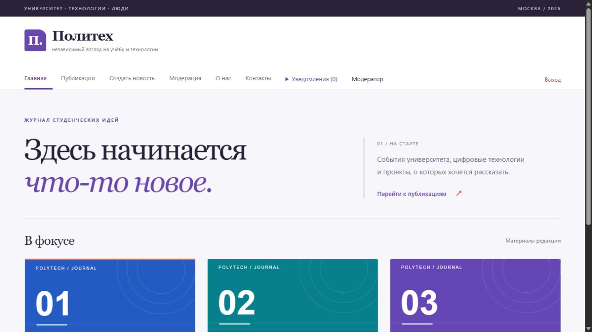

# Политех Журнал

Курсовая работа по дисциплине **«Серверная веб-разработка»**.

Автор: **Завьялов Роман Вячеславович**, группа **257-321**.
Образовательная программа: **«Веб-технологии»**.
Направление: **09.03.01 «Информатика и вычислительная техника»**.
Преподаватель: **Баринов В. Р.**

Тема: **Разработка серверной части новостного веб-приложения на Laravel**.

Основа ЛР 1–9 получена из предоставленного учебного проекта. В рабочую копию добавлены ЛР 10–15 и отдельное журнальное оформление.

## Возможности

| Работа | Реализация |
|---|---|
| ЛР 10 | Очередь database, VeryLongJob, почтовое уведомление модераторов |
| ЛР 11 | NewArticleEvent, публичный канал articles, Pusher SDK, Laravel Echo, Vue, локальный Reverb |
| ЛР 12 | Персональные database-уведомления читателей, счётчик, отметка прочтения |
| ЛР 13 | Кеш списков, пагинации и комментариев; сброс при изменениях |
| ЛР 14 | Учёт успешных просмотров, статистика за день, планировщик и письмо модератору |
| ЛР 15 | JSON API, токены Sanctum, CRUD статей, валидация и проверка ролей |

Сохранены регистрация, web-вход, роли читателя и модератора, комментарии и их модерация.

## Требования

Проверенная среда: PHP **8.5.12**, Composer **2.11.2**, Laravel **13.42.0**. Для сборки интерфейса нужен современный Node.js, совместимый с Vite 8, и pnpm. Нужны расширения PHP: mbstring, openssl, fileinfo, PDO, pdo_sqlite, sqlite3, curl, zip, intl, а также стандартные расширения Laravel.

Методичка курса написана для Laravel 10. Этот проект использует Laravel 13: middleware регистрируется в bootstrap/app.php, а расписание — в routes/console.php. Для вещания используется драйвер pusher с локальным Pusher-совместимым Reverb. Облачное приложение Pusher и внешняя SMTP-почта не подключались.

## Установка на Windows

Из папки проекта в PowerShell:

```powershell
composer install
Copy-Item .env.example .env
php artisan key:generate
New-Item -ItemType File -Path database/coursework.sqlite
php artisan migrate
php artisan db:seed --class=RoleSeeder
php artisan db:seed --class=UserSeeder
php artisan db:seed --class=JournalSeeder
pnpm install --frozen-lockfile
pnpm run build
```

Если файл базы уже существует, повторно создавать его не нужно. Копирование .env.example выполняется при первоначальной настройке, а не поверх собственной рабочей конфигурации.

Файл .env.example настроен на локальную SQLite-базу и SMTP 127.0.0.1:1025. Для приёма тестовых писем установите [Mailpit](https://github.com/axllent/mailpit) из официального источника. Рабочий APP_KEY создаётся локально командой key:generate.

## Запуск

В отдельных терминалах из папки проекта:

```powershell
php artisan serve --host=127.0.0.1 --port=8000
php artisan queue:work database --sleep=1 --tries=3 --timeout=60
php artisan reverb:start --host=127.0.0.1 --port=8080
mailpit --listen 127.0.0.1:8025 --smtp 127.0.0.1:1025
```

Сайт: http://127.0.0.1:8000. Локальная почта: http://127.0.0.1:8025.

Модератор: `moderator@example.com`, пароль `password`.
Читатель: `reader@example.com`, пароль `password`.
Это демонстрационные учётные записи учебного стенда.

В .env указываются COURSEWORK_AUTHOR и COURSEWORK_GROUP для футера. Если меняется конфигурация, очистите её кеш и перезапустите долгоживущие процессы.

## Планировщик

Однократная проверка:

```powershell
php artisan schedule:run
```

Непрерывная проверка расписания во время демонстрации:

```powershell
php artisan schedule:work
```

Команда statistics:send запланирована everyMinute по условию лабораторной работы. Отправляются показатели текущего дня в часовом поясе Europe/Moscow. Просмотры — это успешные запросы статьи, а не уникальные посетители.

## Проверка

```powershell
php artisan test --compact
```

Выполнено **10 тестов и 52 утверждения**. Проверены очередь, роли, отсутствие повторяющегося адресата в одной рассылке, уведомления, database-кеш, статистика и API.

Коллекция Postman: [Coursework.postman_collection.json](Coursework.postman_collection.json). Сначала Login сохраняет token, Create article сохраняет article_id, остальные запросы используют эти переменные. Коллекция проверена Newman: **9 запросов и 9 утверждений без ошибок**. Отчёт без рабочих токенов приведён в [docs/verification.md](docs/verification.md).

## Пояснительная записка

[Подробная пояснительная записка DOCX](docs/Пояснительная_записка.docx)

В записке объяснены назначение файлов, основные термины, порядок выполнения, причины решений и результаты проверок. Скриншоты отражают локальный учебный стенд.



## Состав репозитория

Исходники и файлы зависимостей включены. Рабочая .env, локальные базы, журналы, архивы почты, vendor, node_modules и двоичные файлы PHP/Mailpit не публикуются. Инструменты устанавливаются отдельно, а база создаётся миграциями.

Репозиторий: https://github.com/s1dm4n/laravel
